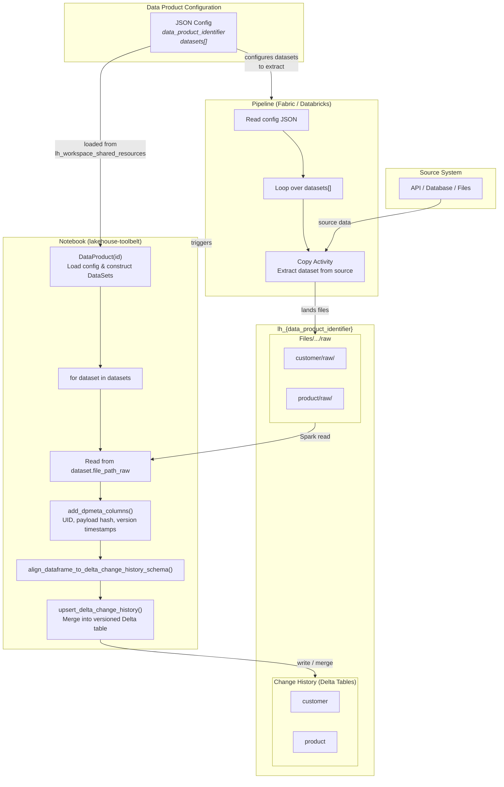

# lakehouse-toolbelt

A Python library for convention-based lakehouse ingestion and Delta change-history upserts in Microsoft Fabric and Databricks. It standardizes how data products are configured, how metadata columns are generated, and how versioned change history is maintained in Delta tables — so that ingestion notebooks follow a consistent, repeatable pattern across datasets and environments.

## Standard Workflow

| Step | API | What happens |
| --- | --- | --- |
| 1. Load configuration | `DataProduct(...)` | Reads a convention-based JSON config and constructs `DataSet` objects with pre-resolved paths |
| 2. Read source data | Spark reader + `dataset.file_path_raw` | Reads raw files from the dataset's landing path |
| 3. Add metadata columns | `add_dpmeta_columns(...)` | Adds `dpmeta_uid`, `dpmeta_payload_hash`, version timestamps, and other columns required for change-history processing |
| 4. Validate schema | `align_dataframe_to_delta_change_history_schema(...)` | Aligns incoming columns to the existing change-history table (recommended, not mandatory) |
| 5. Upsert | `upsert_delta_change_history(...)` | Creates or updates the versioned Delta change-history table |

## Read This First

- [Environment Prerequisites](docs/environment-prerequisites-and-conventions.md)

This page is mandatory reading before implementation. It documents the runtime, lakehouse naming, config file locations, and platform-specific setup for Fabric and Databricks separately.

## Documentation

1. [Environment Prerequisites](docs/environment-prerequisites-and-conventions.md)
2. [Quickstart: CDC Upsert Workflow](docs/quickstart-cdc-upsert.md)
3. [Configuration Reference](docs/configuration-reference.md)
4. [API Reference](docs/function-reference.md)
5. [Schema Compatibility](docs/schema-compatibility.md)
6. [Developing](docs/developing.md)

## Examples

- [Example config](examples/mdm_extract_dat1.json)
- [Example notebook](examples/nb_mdm_extract_cdc_dat1.ipynb)

To load the sample config through `DataProduct("mdm_extract_dat1")`, copy it to the runtime location shown in [Fabric Example Using The Repository Sample Config](docs/environment-prerequisites-and-conventions.md#fabric-example-using-the-repository-sample-config) or [Databricks Example Using The Repository Sample Config](docs/environment-prerequisites-and-conventions.md#databricks-example-using-the-repository-sample-config).

The function-level split between standard workflow functions and lower-level utility functions is documented in [API Reference](docs/function-reference.md).

## Building The Project

See [Developing](docs/developing.md) for full details on the dev container, building, versioning, and the repository folder map.

Quick reference: `hatch build` produces a wheel in `dist/`.
